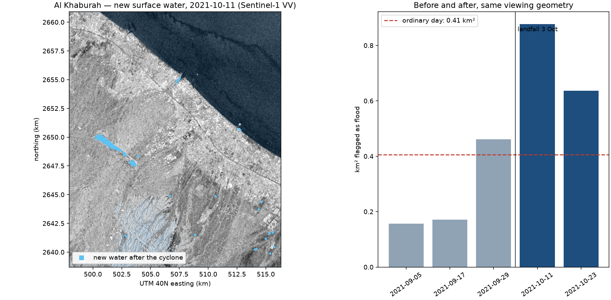
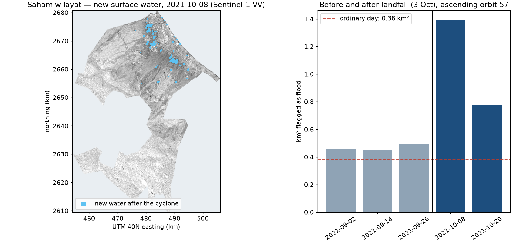
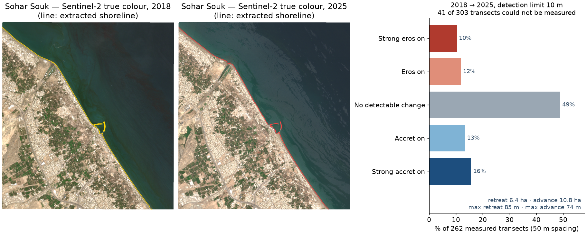
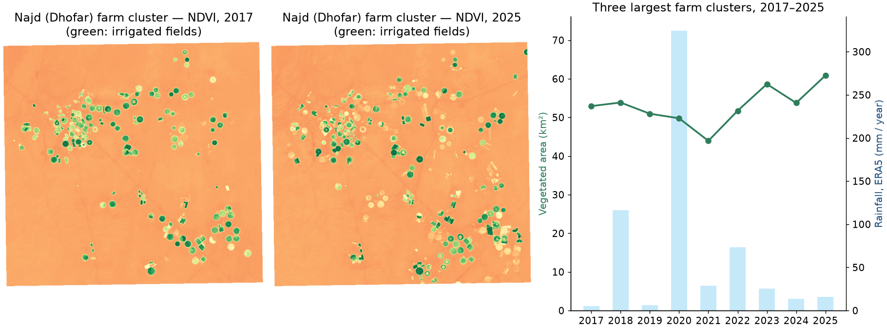

# Madar Oman — flood evidence through cloud, with a stated noise floor

**Team T0045 · Madar Oman (Oman Orbit) · Sultanate of Oman**
**Theme 01 — Climate Adaptation and Disaster Recovery** · Arab Youth Space Hackathon 2026: Challenge 813

Madar Oman maps new surface water from Sentinel-1 radar after a storm and publishes, beside every
figure, how much "flood" the same method reports on an ordinary day — so a decision-maker knows
whether the map shows an event or noise.

[](https://colab.research.google.com/github/qaisalbadaai/madar-oman-poc/blob/main/notebooks/01_flood_shaheen_khaburah.ipynb)



*Al Khaburah, 11 October 2021: 0.88 km² of new water against 0.41 km² on an ordinary day.
Produced by `notebooks/01_flood_shaheen_khaburah.ipynb` from the files in `data/sample_input/`.*

---

## 1. The business use case

**User.** The duty analyst at a civil-defence or municipal operations room in Oman, and the engineers
and loss adjusters who assess damage afterwards.

**Decision.** In the days after a cyclone or flash flood: which neighbourhoods and roads to reach
first, where to send assessment teams, and — weeks later — which claims and repair budgets the
evidence supports.

**What they use today.** Field reports, phone calls and social media during the event; optical
satellite images once the sky clears; global automatic flood products that are not tuned for desert
terrain and come without a statement of how much of the mapped water is false.

**What we sell.** An operations-centre subscription for public bodies, per-event analysis reports for
insurers and consultancies, and on-premise deployment for agencies with data-residency rules.

## 2. The problem

Oman's worst floods arrive under total cloud cover. After the flash floods of 14–15 April 2024 the
first usable Sentinel-2 scene came on 29 April with 17–75 % cloud — two weeks late. Radar sees through
cloud, but it has its own trap here: **fine dry sand is as smooth and as dark as standing water at
C-band**, so a simple threshold over northern Oman reports floods that never happened. And flood maps
are normally published without saying how much of the mapped area would also appear on a dry day.

Satellite radar is the right instrument because it is the only one that observes the whole coast
during and immediately after the storm, at 10–20 m, for free, every few days.

## 3. Data used

| Dataset | Provider | Dates | Level | Licence | Use |
|---|---|---|---|---|---|
| Sentinel-1 RTC, VV (`sentinel-1-rtc`) | ESA / Copernicus, served by Microsoft Planetary Computer | 7 Jul – 23 Oct 2021, 10 passes, descending relative orbit 93 | Radiometrically terrain-corrected gamma0 | Copernicus Sentinel data, free, full and open | Backscatter for the baseline and the flood masks |
| Copernicus DEM GLO-30 | ESA / Copernicus | static | 30 m DSM | Free for any use with attribution | Slope > 5° excluded (radar shadow) |
| ESA WorldCover 10 m | ESA | 2021 | Land-cover map | CC BY 4.0 | Permanent water (class 80) excluded |

`data/sample_input/manifest.json` lists the exact Sentinel-1 scene IDs behind every file. The sample
is clipped to the study area (56.98–57.16° E, 23.86–24.06° N; 406 km²) on a 20 m UTM 40N grid and
stored as dB × 100 in int16 — 14 MB in total. `scripts/export_sample.py` is the script that produced
it.

**Hyperspectral data.** This notebook does not use it: the result it reproduces is a radar result.
In the wider platform, every spectral index is restricted in code to Satellite 813's 400–1700 nm
range, so an index that needs the 2200 nm region (the standard burn ratio, for one) is refused rather
than computed on an analogue sensor that 813 cannot follow. One EnMAP before/after pair over Ibra /
Al Qabil (22 Feb 2024 and 22 May 2025) has been located; it is fifteen months apart and supports
geomorphic change only. No 813 data has been processed yet.

## 4. Technical approach

In execution order, exactly as the notebook runs it:

1. **Read** ten Sentinel-1 VV passes of one viewing geometry, already on a common 20 m grid.
2. **Baseline.** The per-pixel median of the five passes before the analysis period (7 Jul – 24 Aug
   2021): what this ground normally looks like from this angle. Passes are never compared across
   viewing geometries.
3. **Flood mask per pass.** A pixel is flood if VV < −16 dB now, **and** the baseline is not below
   −16 dB, **and** it is not on a slope over 5° or mapped permanent water. Connected patches under
   0.5 ha are removed as speckle.
4. **Event split.** Passes before the landfall date (3 October 2021) are ordinary days; passes after
   it are candidates.
5. **Noise subtraction.** From each post-event mask, remove every pixel that was flagged on any
   pre-event pass. What remains is *new water*.
6. **Null test.** Apply the same subtraction to the last pre-event pass using the ones before it. The
   area that survives is what the method reports when nothing happened.
7. **Decision.** A flood is declared only if new water exceeds the null figure.

No machine-learning model and no random numbers are involved; the result is deterministic.

## 5. Installation

Requires Python 3.11.

```bash
git clone https://github.com/qaisalbadaai/madar-oman-poc.git
cd madar-oman-poc
python -m venv .venv && source .venv/bin/activate
pip install -r requirements.txt
```

No API keys, tokens or environment variables are needed.

## 6. How to run

```bash
jupyter lab notebooks/01_flood_shaheen_khaburah.ipynb
```

Run all cells. Nothing needs editing. Runtime is under one minute on a standard laptop, no GPU and no
network. To run it without opening a browser:

```bash
jupyter nbconvert --to notebook --execute --inplace notebooks/01_flood_shaheen_khaburah.ipynb
```

At the end the notebook prints the headline line and writes three files to `results/`.

## 7. Example input and output

**Input** — `data/sample_input/`

| File | What it is |
|---|---|
| `s1_vv_YYYYMMDD_baseline.tif` (5) | Passes used for the baseline |
| `s1_vv_YYYYMMDD_analysis.tif` (5) | Three passes before the cyclone, two after |
| `excluded_slope_or_permanent_water.tif` | 1 where the ground is too steep or is permanent water |
| `inside_area.tif` | 1 inside the study area |
| `manifest.json` | Grid, encoding, event date and Sentinel-1 scene IDs |

**Output** — `results/`

| File | What it is |
|---|---|
| `khaburah_flood_shaheen_2021.png` | The map and the before/after chart shown at the top of this page |
| `khaburah_flood_summary.json` | The figures, per pass |
| `khaburah_new_water_mask.tif` | The new-water mask as a GeoTIFF, ready for a GIS |

## 8. Results and limitations

| Pass | Flood mask | New water | Ordinary day | Above noise |
|---|---|---|---|---|
| 11 Oct 2021 | 0.88 km² | **0.88 km²** | 0.41 km² | yes |
| 23 Oct 2021 | 0.65 km² | 0.64 km² | 0.41 km² | yes |

About half of the new water is the Wadi Al Hawasnah dam reservoir filling. The full platform finds
new water above its noise floor in the second viewing geometry (ascending 57) as well.

The same method on other areas of the Cyclone Shaheen coast, run in the full platform:

| Area | New water | Ordinary day | Reading |
|---|---|---|---|
| Saham wilayat | 1.40 km² | 0.37 km² | Detected; 2.96 km of roads and 0.26 km² of built-up land inside it |
| Al Musannah wilayat (landfall) | 2.17 km² | 2.03 km² | **Not distinguishable from noise** — reported as such |
| As Suwayq, Sohar | — | — | Not analysable: too few usable radar passes. The platform stops and says so |

### Other cases from the same platform

These figures are outputs of the full Madar Oman platform, included to show the range of the work.
They are not produced by the notebook in this repository.

**Flood — Saham wilayat, Cyclone Shaheen.** The same method on a whole wilayat (1,497 km², 40 m
grid, ascending orbit 57): 1.40 km² of new water on 8 October 2021 against 0.37 km² on an ordinary
day, with 2.96 km of mapped road and 0.26 km² of built land inside it.



**Coastal change — Sohar Souk, Al Batinah coast, 2018 → 2025.** Shoreline extracted from Sentinel-2
year by year and measured on 303 transects at 50 m spacing along 15.1 km; 262 could be measured.
With a detection limit of 10 m (one pixel), of the measured transects 49 % show no detectable
change, 29 % accretion and 22 % erosion; 6.4 ha
retreated and 10.8 ha advanced. At Saham, where the usable record gives a 45.8 m limit, 97 % show no
detectable change — the limit is printed with every result so "no change" is never confused with
"not measurable".



**Drought and agriculture — Najd, Dhofar, 2017 → 2025.** Vegetated area of the three largest farm
clusters from Sentinel-2 NDVI, against ERA5 rainfall: between 43.9 km² (2021) and 60.9 km² (2025).
The area does not follow rainfall — these farms are irrigated from groundwater — which is what a
water planner needs to see.



**How it was validated.** By the null test above and by agreement between two independent viewing
geometries. That is internal consistency, **not** ground truth.

**Where it breaks.**

- The first usable pass is eight days after landfall; the flood peak was not observed.
- Radar cannot see water between buildings, so urban flooding is under-counted.
- A −16 dB threshold misses wind-roughened or vegetated water.
- There is no field survey of this event, and none of the April 2024 floods.
- The sample holds one viewing geometry; numbers differ from the platform's by under 0.01 km² because
  the sample stores backscatter rounded to 0.01 dB.

## 9. Repository layout

```
madar-oman-poc/
├── README.md
├── requirements.txt                            pinned versions (environment.yml and Dockerfile also provided)
├── notebooks/01_flood_shaheen_khaburah.ipynb   runs end to end, outputs committed
├── data/sample_input/                          14 MB of clipped Sentinel-1 and masks
├── results/                                    figure, summary, GeoTIFF mask
│   └── platform/                               figures of other cases from the full platform
├── scripts/export_sample.py                    how the sample was produced
└── docs/slides.pdf
```

## 10. Team, licence and attribution

**Team T0045 — Madar Oman**

| Member | Role |
|---|---|
| Reem Alklbani | Team lead and management |
| Qais Albadaai | AI programming and operations |
| Anat Alaisaee | Platform design |

Code: MIT (see `LICENSE`). Contains modified Copernicus Sentinel data 2021, processed by ESA and
served by the Microsoft Planetary Computer. Copernicus DEM © DLR e.V. 2010–2014 and © Airbus Defence
and Space GmbH 2014–2018, provided under COPERNICUS by the European Union and ESA. ESA WorldCover
2021 © ESA WorldCover project, CC BY 4.0. Built with NumPy, SciPy, Rasterio and Matplotlib.

Madar Oman is not a warning system. Oman's official authority is the Civil Aviation Authority's
National Multi-Hazard Early Warning Centre.
